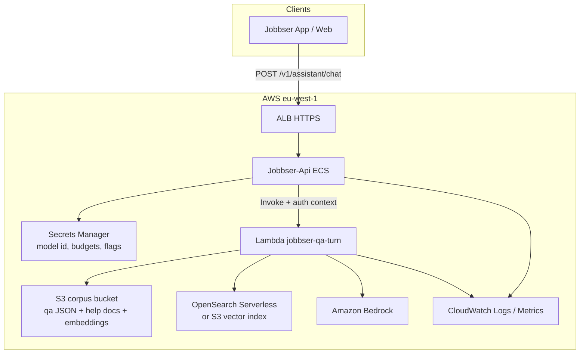
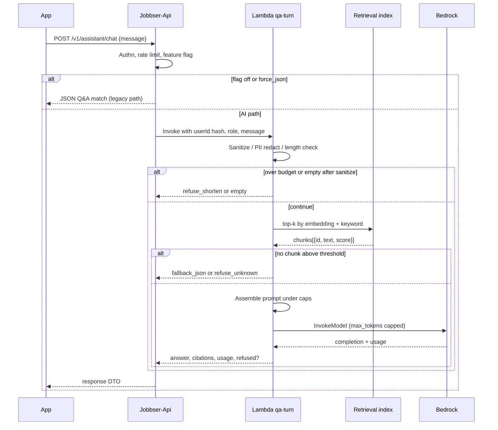

# Architecture: guarded Jobbser Q&A on AWS

Design target for Task 6. Shapes sit next to the inventory (ECS API, ALB, S3,
Secrets Manager, eu-west-1). No account IDs or real ARNs.

---

## Goal

Replace the in-app JSON Q&A bot with a **retrieval-augmented** turn that:

1. Only answers from an **allowed Jobbser corpus**
2. **Refuses** off-topic and unsafe asks
3. Stays inside a **token budget**
4. Can **fall back** to the migrated JSON answers when confidence is low

Not in scope: a general chatbot, browsing the public web, or reading RDS user data.

---

## Component diagram



---

## Sequence for one chat turn



---

## Why Lambda beside the API (not inside Fargate)

| Option | Pros | Cons | Pick? |
| --- | --- | --- | --- |
| Call Bedrock from Jobbser-Api ECS task | Fewer moving parts | Couples AI latency/IAM to the main API; harder to isolate timeouts | No for v1 |
| **API → Lambda → Bedrock** | Burst scale, separate timeout/memory, clear blast radius, matches inventory “Lambdas are a growth area” | Extra hop | **Yes** |
| API Gateway + Lambda only (bypass API) | Pure serverless | Duplicates auth / rate limits the API already owns | No |

The API remains the product front door. Lambda is an internal worker for one turn.

---

## Retrieval backend choice

I sketch **two** acceptable backends. Kickoff picks one.

### A. OpenSearch Serverless (vector): preferred if volume grows

- Embeddings stored as k-NN vectors
- Hybrid BM25 + vector for short FAQ questions (JSON titles match well on keywords)
- Collection sized small; pay for OCU when used

### B. S3 + embeddings sketch: preferred for first slice

- Corpus JSON/Markdown in S3
- Embeddings as a versioned `index/embeddings.jsonl` (or `.npy` + id map) rebuilt by a
  nightly / on-publish Lambda
- Query-time: embed question with Bedrock Titan Embeddings (or equivalent), cosine
  top-k in the Lambda for a small corpus (hundreds of chunks is fine in memory)

For Jobbser’s current JSON-sized FAQ, **B is enough**. I would start with B and
graduate to A when chunk count or latency demands it. Both stay closed-corpus.

---

## IAM sketch (least privilege)

- **API task role:** `lambda:InvokeFunction` on `jobbser-qa-turn` only; read its own
  Secrets Manager secret (already true today).
- **Lambda execution role:**
  - `bedrock:InvokeModel` on the chosen model ARNs only
  - `s3:GetObject` on the corpus bucket prefix
  - `aoss:APIAccessAll` (or equivalent) only if using OpenSearch Serverless
  - Write logs to its own log group
- **No** Lambda access to RDS, Stripe secrets, or the uploads bucket with profile images.

---

## Config in Secrets Manager

Extend the per-env API secret (or a sibling `jobbser/{env}/assistant`) with:

```json
{
  "assistant": {
    "enabled": true,
    "mode": "canary",
    "canaryPercent": 10,
    "bedrockModelId": "anthropic.claude-3-haiku-...",
    "embedModelId": "amazon.titan-embed-text-v2:0",
    "maxSystemTokens": 450,
    "maxContextTokens": 1200,
    "maxUserTokens": 400,
    "maxResponseTokens": 350,
    "retrievalTopK": 4,
    "minScore": 0.72,
    "fallback": "json"
  }
}
```

Placeholders only. No real keys in this package.

---

## Failure modes

| Failure | Behaviour |
| --- | --- |
| Bedrock throttle / 5xx | Retry once with jitter; then JSON fallback or “help is temporarily limited” |
| Empty retrieval | Do **not** invent; JSON fallback if keyword match, else refuse_unknown |
| Low score chunks only | Same as empty retrieval |
| User message over cap | Refuse shorten; no Bedrock call |
| Classifier: clear off-topic | Refuse; skip Bedrock when rule-based hit is enough |
| Lambda timeout | API returns fallback; metric `assistant.timeout` |

---

## Where this sits next to inventory services

- **Does not** add a second always-on ECS service for chat
- **Does** add on-demand Lambda + Bedrock token spend + small S3 corpus
- Reuses ALB → API path clients already know
- Leaves MsgHub alone (chat answers are request/response, not a new realtime channel)
- Workers never billed; no Stripe touch in this path

---

## Out of scope for this design

- Multi-turn conversational memory beyond the current request (v1 is single-turn +
  optional short client-supplied history capped at 2 prior turns under the same budget)
- Voice / image input
- Writing tickets or mutating jobs via the assistant
- Training / fine-tuning a custom model
